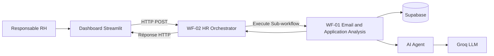

import pypandoc, os
md = """# NEXUS HR — Assistant RH intelligent

> Un assistant RH augmenté par l’intelligence artificielle pour analyser les candidatures, traiter les demandes RH et faciliter la prise de décision.

## 1. Présentation du projet

NEXUS HR est une solution d’assistance destinée au responsable des ressources humaines. Elle combine une interface web, des workflows d’automatisation, une base de données et un modèle de langage afin de centraliser plusieurs tâches RH et de réduire les opérations manuelles répétitives.

La solution repose sur quatre composants principaux :

- **Streamlit** : interface web du responsable RH.
- **n8n** : orchestration des workflows et circulation des données.
- **Supabase** : stockage et consultation des données RH.
- **Groq** : accès au modèle de langage utilisé pour l’analyse et la génération de réponses.

Le projet est un prototype évolutif. Les résultats produits par l’IA doivent être vérifiés par le responsable RH avant toute décision concernant un candidat ou un employé.

## 2. Problématique

Le traitement des candidatures, des CV et des e-mails RH peut demander beaucoup de temps. Le responsable RH doit lire les documents, extraire les informations pertinentes, comprendre les demandes, retrouver les données utiles et préparer des synthèses. Ces opérations peuvent être répétitives et les informations peuvent être dispersées entre plusieurs outils.

NEXUS HR vise à simplifier ce travail en proposant un point d’accès unique à des fonctions d’assistance alimentées par l’IA et reliées aux données disponibles dans l’organisation.

## 3. Objectifs

### Objectif général

Développer un assistant RH intelligent qui aide le responsable RH à analyser des informations, interroger les données disponibles et automatiser certains traitements à travers une interface centralisée.

### Objectifs spécifiques

1. Centraliser les fonctionnalités RH dans un dashboard web.
2. Assister l’analyse des candidatures à partir des informations du candidat et du texte de son CV.
3. Faciliter l’analyse des e-mails et l’identification de leurs éléments importants.
4. Permettre une interaction en langage naturel avec un assistant RH.
5. Interroger les données RH stockées dans Supabase à travers n8n.
6. Automatiser les échanges entre les composants grâce aux webhooks et aux sous-workflows.
7. Présenter les résultats de manière claire pour aider le responsable RH.

## 4. Public cible et proposition de valeur

### Public cible

Le prototype est destiné principalement au **responsable RH (HR Manager)**.

### Proposition de valeur

NEXUS HR rassemble dans une seule interface des fonctions d’assistance RH alimentées par l’IA et reliées aux données de l’organisation. La solution cherche à réduire le temps consacré au traitement initial des informations, à structurer les analyses et à faciliter l’accès aux données.

L’outil fournit une aide à l’analyse : **la décision finale reste humaine**, notamment pour le recrutement.

## 5. Fonctionnalités du dashboard

Le dashboard est développé avec Streamlit et adopte une interface sombre et moderne.

| Espace | Description |
|---|---|
| **Overview** | Vue d’ensemble de l’activité réalisée depuis le dashboard. |
| **AI HR Assistant** | Permet au responsable RH de poser une question ou de fournir un contexte à analyser. |
| **CV Analysis** | Permet de saisir les informations d’un candidat, le poste visé et le texte de son CV pour demander une analyse. |
| **Email Analysis** | Permet de soumettre l’objet, l’expéditeur et le contenu d’un e-mail pour obtenir une analyse. |
| **HR Analytics** | Présente des indicateurs liés aux actions et aux statuts enregistrés pendant la session. |
| **Activity History** | Affiche l’historique des actions de la session et permet son export CSV. |

**À noter :** les statistiques de session du prototype ne sont pas nécessairement des indicateurs globaux ou des données en temps réel provenant de Supabase. Leur portée dépend des données effectivement renvoyées et enregistrées par l’application.

## 6. Technologies et outils utilisés

### 6.1 Streamlit — Interface utilisateur

Streamlit est le framework Python utilisé pour construire l’application web interactive. Il permet de créer les pages du dashboard, recueillir les informations saisies, envoyer les demandes vers n8n et afficher les résultats.

### 6.2 n8n — Automatisation et orchestration

n8n relie l’interface, la base de données et le modèle d’IA. Deux workflows structurent l’architecture.

#### WF-01 — Email and Application Analysis

Ce sous-workflow est conçu pour traiter les informations liées aux e-mails et aux candidatures. Il comprend :

- **When Called by Orchestrator** : déclenche le workflow lorsqu’il est appelé par un autre workflow.
- **Supabase** : permet de consulter les données disponibles dans la base.
- **AI Agent** : coordonne le traitement par intelligence artificielle.
- **Groq Chat Model** : fournit le modèle de langage utilisé par l’agent.

Le traitement exact dépend de la configuration et des connexions actives dans n8n.

#### WF-02 — HR Orchestrator

Ce workflow sert de point d’entrée pour les requêtes envoyées par le dashboard.

Architecture prévue :

`Webhook → Execute Sub-workflow → Respond to Webhook`

- **Webhook** : reçoit les requêtes HTTP POST du dashboard.
- **Execute Sub-workflow** : appelle WF-01 et lui transmet les données nécessaires.
- **Respond to Webhook** : renvoie une réponse HTTP au dashboard.

Le chemin du webhook est `hr-assistant`. En mode test, l’URL est de la forme `/webhook-test/hr-assistant`. En mode actif, elle est de la forme `/webhook/hr-assistant`.

### 6.3 Supabase — Base de données

Supabase est utilisé comme plateforme de base de données pour les informations RH. Les données sont hébergées dans un projet Supabase et le nœud Supabase de n8n permet de sélectionner et de consulter les tables nécessaires aux traitements.

Les identifiants Supabase sont enregistrés dans les credentials n8n. Les clés secrètes ne doivent jamais être intégrées au code frontend ni publiées dans le dépôt.

### 6.4 Groq — Modèle de langage

Groq fournit l’accès au modèle de langage utilisé par l’AI Agent de n8n.

- **Modèle configuré :** `openai/gpt-oss-120b`
- **Endpoint compatible OpenAI :** `https://api.groq.com/openai/v1`

Le modèle peut comprendre une demande, analyser du texte, structurer une synthèse ou préparer une réponse. La qualité dépend du prompt, du contexte transmis et des données disponibles.

La clé API Groq doit rester dans les credentials n8n ou dans un gestionnaire de secrets adapté.

### 6.5 Docker et Docker Desktop — Exécution des services

Docker permet d’exécuter les services dans des conteneurs isolés. Il est utilisé pour exécuter n8n localement, ses services complémentaires, et le dashboard Streamlit.

- Port du dashboard : `8501`
- Port de n8n : `5678`
- Depuis le conteneur Streamlit, `host.docker.internal` permet d’accéder au service n8n exposé sur la machine hôte.

Cette approche permet d’exécuter les dépendances Python du dashboard dans le conteneur, sans devoir les installer directement dans Windows.

### 6.6 Visual Studio Code — Environnement de développement

VS Code est l’éditeur utilisé pour modifier les fichiers Python, gérer les fichiers du projet, utiliser le terminal intégré et exécuter les commandes Docker.

Extensions utiles :
- **Python** (Microsoft)
- **Pylance** (Microsoft)
- **Docker** (Microsoft)

### 6.7 Python et bibliothèques

Le dashboard est écrit en Python. Les dépendances sont déclarées dans `requirements.txt` :

- `streamlit` : interface web ;
- `requests` : appels HTTP vers le webhook n8n ;
- `pandas` : manipulation et export de données tabulaires.

Dans la configuration Docker, ces dépendances sont installées dans l’image du dashboard.

## 7. Architecture générale



### Déroulement d’une requête

1. Le responsable RH choisit une fonctionnalité dans le dashboard.
2. Streamlit prépare une requête contenant un identifiant, une action et les données saisies.
3. Streamlit envoie la requête au webhook WF-02.
4. WF-02 transmet les données au sous-workflow WF-01.
5. WF-01 peut consulter Supabase et solliciter l’AI Agent connecté à Groq.
6. Le résultat remonte vers WF-02.
7. `Respond to Webhook` renvoie la réponse à Streamlit.
8. Le dashboard affiche le résultat au responsable RH.

## 8. Format des données échangées

Le dashboard prépare une structure JSON de ce type :

```json
{
  "request_id": "identifiant-unique",
  "user_id": "hr-manager",
  "action": "analyze_application",
  "source_type": "cv",
  "data": {
    "candidate_name": "Nom du candidat",
    "position": "Poste visé",
    "email": "adresse@example.com",
    "cv_text": "Contenu textuel du CV"
  },
  "attempt": 1,
  "hr_feedback": ""
}
```

Actions prévues notamment :
- `hr_assistant`
- `analyze_application`
- `analyze_email`

Les champs doivent rester cohérents entre le code Streamlit, le webhook WF-02 et les entrées attendues par WF-01.

## 9. Installation et lancement

### Prérequis

- Windows avec Docker Desktop installé et démarré ;
- Visual Studio Code ;
- le projet NEXUS HR téléchargé localement ;
- les workflows n8n configurés ;
- les credentials Supabase et Groq configurés dans n8n.

### Accéder à n8n

Si l’environnement n8n est déjà démarré :

`http://localhost:5678`

Ne pas supprimer les volumes Docker existants : ils peuvent contenir les données et la configuration persistantes de n8n.

### Construire l’image du dashboard

Depuis le dossier contenant `Dockerfile`, `app.py` et `requirements.txt` :

```powershell
docker build -t nexus-hr-dashboard .
```

### Lancer le dashboard

Pour un webhook n8n en mode test :

```powershell
docker run -d --name nexus-hr-dashboard -p 8501:8501 -e N8N_WEBHOOK_URL=http://host.docker.internal:5678/webhook-test/hr-assistant nexus-hr-dashboard
```

Ouvrir ensuite :

`http://localhost:8501`

Pour utiliser le webhook en mode actif, remplacer `/webhook-test/hr-assistant` par `/webhook/hr-assistant`, après activation de WF-02 dans n8n.

### Commandes Docker utiles

Afficher les conteneurs actifs :

```powershell
docker ps
```

Afficher tous les conteneurs :

```powershell
docker ps -a
```

Consulter les logs du dashboard :

```powershell
docker logs -f nexus-hr-dashboard
```

Arrêter le dashboard :

```powershell
docker stop nexus-hr-dashboard
```

Redémarrer le conteneur existant :

```powershell
docker start nexus-hr-dashboard
```

Supprimer uniquement le conteneur du dashboard (après l’avoir arrêté) :

```powershell
docker rm nexus-hr-dashboard
```

Après une modification du code, reconstruire l’image et recréer le conteneur du dashboard. Ne pas supprimer les volumes n8n.

## 10. Configuration et sécurité

- Conserver les clés API Groq et les clés Supabase dans les credentials n8n ou dans des variables d’environnement sécurisées.
- Ne jamais publier un fichier `.env` contenant des secrets.
- Le fichier `.env.example` ne doit contenir que des exemples fictifs ou des noms de variables.
- Limiter l’accès au dashboard et à n8n aux personnes autorisées.
- Ne transmettre à des services externes que les données personnelles nécessaires, conformément aux règles applicables.
- Ne pas utiliser les sorties de l’IA comme décision automatique de recrutement.
- Prévoir une validation humaine des analyses, particulièrement pour l’évaluation des candidatures.

## 11. État du prototype et points à valider

Le projet est un prototype en cours d’intégration. Les éléments suivants doivent être testés de bout en bout avant de considérer la solution comme pleinement opérationnelle :

- réception des requêtes par le webhook WF-02 ;
- appel effectif de WF-01 par `Execute Sub-workflow` ;
- correspondance entre le JSON envoyé et les entrées attendues par WF-01 ;
- exécution correcte des requêtes Supabase ;
- réponse de l’AI Agent et du modèle Groq ;
- retour d’une réponse exploitable par `Respond to Webhook` ;
- affichage du résultat dans Streamlit ;
- gestion des erreurs, délais d’attente et requêtes invalides.

### Améliorations envisagées

1. Ajouter une authentification pour le responsable RH.
2. Enregistrer durablement l’historique des analyses dans Supabase.
3. Définir des schémas de validation pour les entrées et sorties des workflows.
4. Ajouter une gestion explicite des erreurs et des statuts.
5. Alimenter les indicateurs analytiques à partir de données persistantes et vérifiées.
6. Ajouter des tests automatisés pour les appels API et les workflows.
7. Définir des règles de confidentialité, de conservation et de suppression des données.
8. Améliorer les prompts et évaluer la fiabilité des analyses IA.

## 12. Structure du projet

```text
nexus_hr_streamlit_dashboard/
│
├── app.py                 # Interface principale Streamlit
├── n8n_client.py          # Client HTTP pour appeler le webhook n8n
├── requirements.txt       # Dépendances Python
├── Dockerfile             # Construction de l’image Docker
├── .env.example           # Exemple de variables de configuration
└── README.md              # Documentation du projet
```

## 13. Conclusion

NEXUS HR associe une interface accessible, l’automatisation des processus, une base de données centralisée et un modèle de langage. Streamlit facilite l’interaction avec le responsable RH, n8n orchestre les traitements, Supabase fournit les données et Groq apporte les capacités d’analyse linguistique.

L’ambition est de faire gagner du temps au responsable RH, de mieux structurer les informations et de faciliter les tâches administratives et analytiques, tout en maintenant le contrôle humain sur les décisions importantes.
"""
out = "/mnt/data/README_NEXUS_HR.md"
pypandoc.convert_text(md, "md", format="md", outputfile=out, extra_args=["--standalone"])
print(f"Fichier créé : {out} ({os.path.getsize(out)} octets)")
